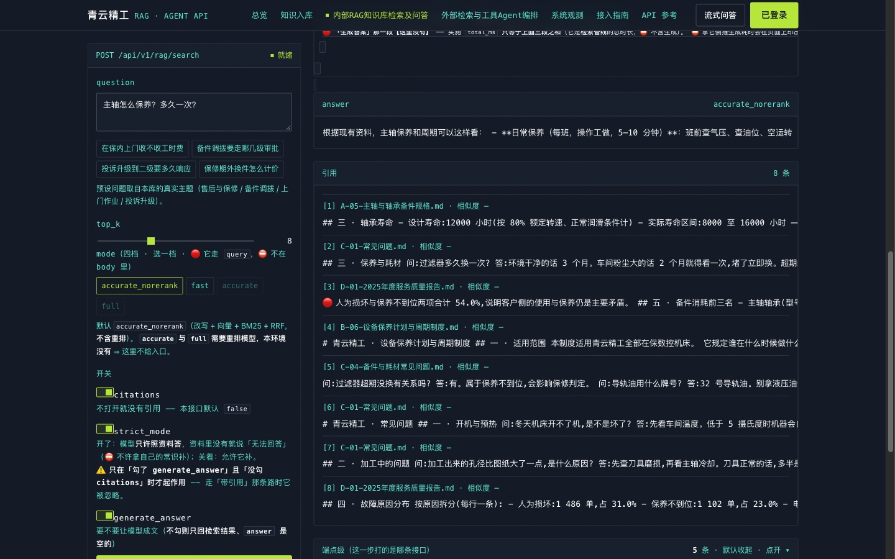
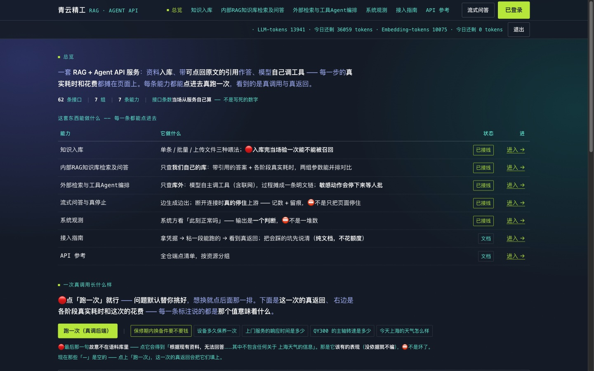
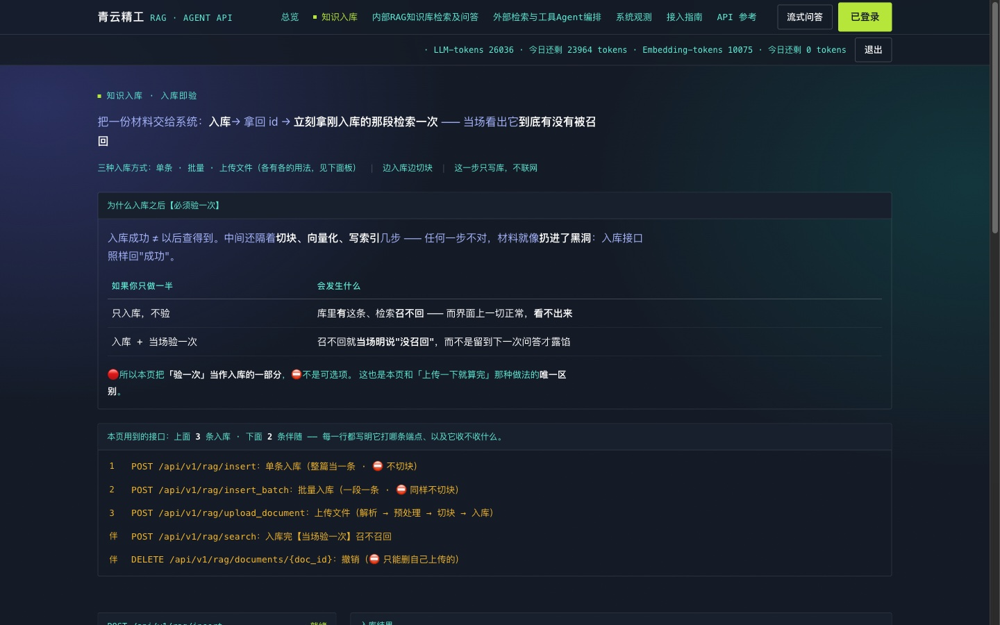
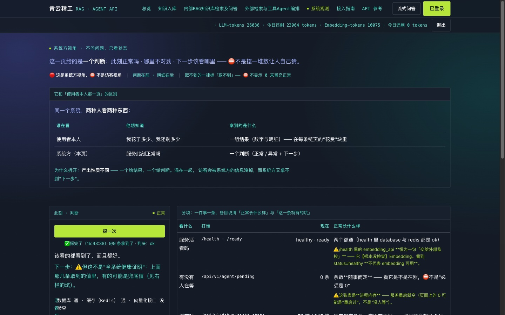
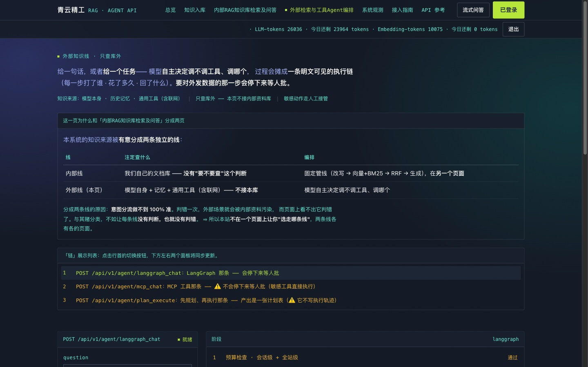
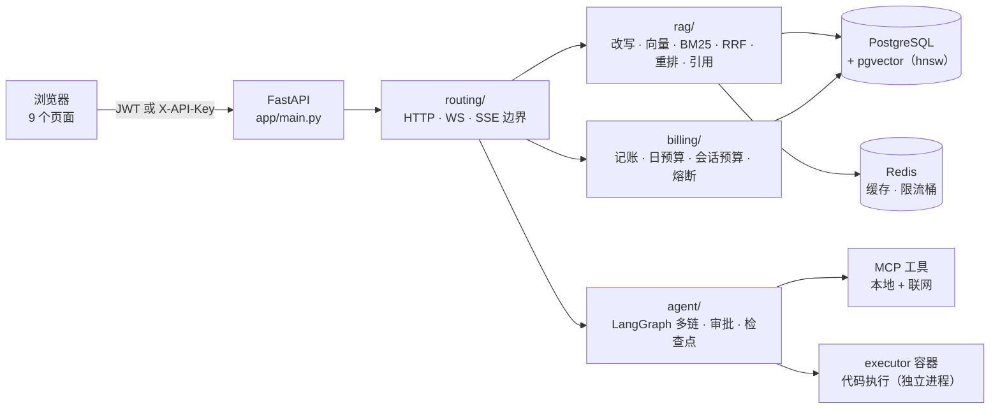

<div align="center">

# 青云精工 · RAG + Agent API 服务

**一个生产级的检索增强生成（RAG）与 Agent 编排后端** ——
混合检索 · 重排序 · 查询改写 · 引用溯源 · LangGraph Agent · MCP 工具 · 按用户计量的成本控制

[](https://github.com/heweidong-ecco/qingyun-rag-agent/actions/workflows/ci.yml)
[](LICENSE)


### 🔗 [**在线演示 → qingyun.paleoix.com**](https://qingyun.paleoix.com)

**不是截图，是真在跑的服务** —— 登录之后可以真上传文档、真检索、真提问，每一页的操作都真的调后端。

</div>

---

> ⚠️ **免费额度有限**（embedding 走的是免费 key）。跑满会返回 **429** ——
> 那是**成本闸在工作**，⛔ 不是坏了。见「成本控制」那一节。

## 目录

- [这是什么](#这是什么)
- [界面](#界面)
- [架构](#架构)
- [它能干什么](#它能干什么)
- [快速开始](#快速开始)
- [用一条 `curl` 试试](#用一条-curl-试试)
- [值得一看的三处](#值得一看的三处)
- [目录结构](#目录结构)
- [许可证](#许可证)

---

## 这是什么

把「**一堆文档**」变成「**一个能答问题、并且能说出答案出自哪一段**」的服务。
它同时是一套 **Agent 编排平台** —— 工具调用、计划-执行、长期记忆、人工审批点，
以及一条**贯穿所有调用**的**成本闸**。

它不是玩具：**多用户隔离 · 成本控制 · 成本可观测** 都是承重的设计，
而不是"加在边上的一层"。见下面「值得一看的三处」。

## 界面

> 🔴 **这些不是设计稿，是【真跑起来】的页面** —— 检索那一张里是**真答案、真引用（8 条，带相似度）**，
> 系统观测那一张是**真探的结果**。

### 检索问答 —— 「一句话进来，出去的是带引用的答案」

[](docs/截图/02-检索问答.jpg)

左边是**这次请求的原文与开关**，右边是**答案 + 引用列表** ——
每条引用都能点开看原文。⚠️ 注意那个坑：**`generate_answer` 与 `citations` 默认都是 `false`**，
不显式打开就只回检索结果、**不生成答案**（见下方 `curl` 示例）。

### 总览 —— 「每一页能看到什么、点得进去哪」

[](docs/截图/01-总览.jpg)

### 知识入库 —— 「入库完当场验一次」

[](docs/截图/03-知识入库.jpg)

### 系统观测 —— 「一个判断，不是一堆数」

[](docs/截图/04-系统观测.jpg)

### Agent 编排 —— 多条链、带工具与审批点

[](docs/截图/05-Agent编排.jpg)

## 架构



**两条贯穿性的设计**：

- 🔴 **身份用显式形参贯穿**（`user_id` / `thread_id` 都是**必填关键字**）——
  有一条结构守卫钉着「每个调用点都得传」，⛔ 不靠"记得传"。
- 🔴 **成本闸的桶必须与账本的桶一致** —— 记账落一个 `thread_id`、闸查另一个，
  闸就会**恒看到 0**（= 形同虚设）。

## 它能干什么

| 能力 | 说明 |
|---|---|
| **混合检索** | 向量（pgvector） + BM25 关键词 + **RRF 融合**；支持查询改写与查询扩展 |
| **重排序** | Cross-Encoder 精排（可选链路，默认不装重排依赖以保持镜像小 —— 那两档在页面上**标明不可点**）|
| **引用溯源** | 答案带 `[来源 n]` 标注，与返回的 `sources[]` **一一对应** |
| **Agent 编排** | **LangGraph** 多链（工具编排 / 计划-执行 / 记忆 / MCP）；带**人工审批点**与**检查点续跑** |
| **工具生态** | **MCP** 协议；本地工具 + 联网检索 + **独立容器里的代码执行器** |
| **长期记忆** | mem0 驱动的跨会话记忆；写入与检索**都纳入计量** |
| **多用户隔离** | 检索、写入、删除**全部按 `requested_by` 过滤**；另有全站共享的公共语料层 |
| **成本控制** | 三层闸：**角色日预算** · **会话预算** · **全站熔断**；每次调用**逐条记账** |

## 快速开始

```bash
git clone https://github.com/heweidong-ecco/qingyun-rag-agent.git
cd qingyun-rag-agent
cp .env.example .env          # 填上 DASHSCOPE_API_KEY 等 —— 见 docs/契约/环境变量.md
docker compose up -d
```

起来之后打开 <http://localhost:8000/>：

| 地址 | 是什么 |
|---|---|
| `/` | 总览首页（企业仪表盘） |
| `/kb` | 知识入库：上传 / 列出 / 删除 |
| `/rag` | 内部 RAG 知识库检索及问答 |
| `/agent` | 外部检索与工具 Agent 编排 |
| `/ops` | 系统观测（限流 / 配额 / 工具健康） |
| `/guide` | 接入指南 |
| `/reference` | API 参考（**由探针生成**，⛔ 不手改） |
| `/stream` | 流式问答 |
| `/docs` | OpenAPI |

> ⚠️ **第一次跑**：库里是空的 ⇒ 想看到非空结果，先在 `/kb` 传一篇文档。
> 📄 更细的部署说明 ⇒ `docs/说明/部署.md`

## 用一条 `curl` 试试

```bash
# 1) 换一个访问令牌
TOKEN=$(curl -s -X POST http://localhost:8000/api/v1/auth/login \
  -H 'Content-Type: application/json' \
  -d '{"user_name":"admin","password":"<你的口令>"}' | python -c 'import sys,json;print(json.load(sys.stdin)["access_token"])')

# 2) 问一句（generate_answer 默认是 false ⇒ 要出答案必须显式打开）
curl -s -X POST "http://localhost:8000/api/v1/rag/search?thread_id=t1" \
  -H "Authorization: Bearer $TOKEN" -H 'Content-Type: application/json' \
  -d '{"question":"主轴怎么保养？","top_k":3,"generate_answer":true,"citations":true}' \
  | python -m json.tool
```

> 🔴 **`generate_answer` 与 `citations` 默认都是 `false`** ——
> 不显式打开就只返回 `docs`（**不生成答案、更不会有引用**）。
> 这是**最容易在演示时翻车的点**：它看起来像「这个能力不存在」，其实是**接口的默认值**。

## 值得一看的三处

1. 🔴 **向量检索会【静默少回结果】** —— 近似索引**先扫索引、后套 `WHERE`** ⇒
   带过滤的检索会**少于 `LIMIT`**（实测：不带防护时 32% 的查询拿不满 `top_k`）。
   本仓的做法：每次 ANN 查询前 `SET LOCAL … iterative_scan`，
   并**在启动时拒绝 pgvector < 0.8**（否则那个开关会**静默失效**）。
   ⇒ `app/core/db.py`
2. 🔴 **成本闸的桶必须与账本的桶一致** —— 记账落一个 `thread_id`、闸查另一个的话，
   闸会**恒看到 0**（= 那道闸形同虚设）。⇒ `app/billing/token_tracker.py` · `app/rag/rag_pipeline.py`
3. 🔴 **工具执行不在应用进程里** —— `execute_python` 走**独立容器**，
   应用**不碰 `docker.sock`**。⇒ `app/tools/code_executor.py` · `docker-compose.yml` 的 `executor`

## 目录结构

```
app/          应用本体（core · routing · access · billing · agent · rag · tools）
  <组>/specs/   ⭐ 每个模块的规格 —— 与模块【同目录】
                最该读的是每份 spec 的「看代码会误判的地方」那一节
docs/
  契约/        接口 · 环境变量 · 表结构（对外承诺）
  原理/        架构 · 请求流 · 依赖方向
  说明/        部署 · 运维 · 测试
  规范/        开发规范（含判据纪律）
frontend/     前端的设计文档与形态稿（⛔ 真前端代码在 app/static/）
testdata/     示例语料
locust/       压测
```

## 技术栈

| | |
|---|---|
| **后端** | FastAPI · PostgreSQL + **pgvector**（`hnsw`）· Redis · LangChain / LangGraph · MCP · mem0 |
| **前端** | 原生 HTML / CSS / JS（**无构建步骤**）· 9 个页面 |
| **质量** | pytest（**离线** + **真库**两档）· CI · 提交前的结构门（凭据 / 断链 / 孤儿 / 静态检查 …）|

## 许可证

**MIT** —— 见 [`LICENSE`](LICENSE)。
